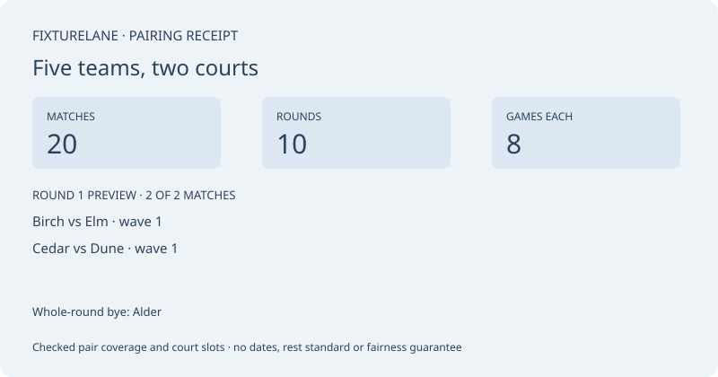

# Fixturelane

**Every pairing, accounted for.**

[Open Fixturelane](https://fixturelane.vercel.app) · [Automated checks](https://github.com/KingReaper6940/fixturelane/actions/workflows/checks.yml)

Generate checked single or double round-robin fixtures for players or fixed teams. Place each round on your courts in sequential waves, inspect whole-round byes and take the complete schedule with you.



This is an actual generated SVG summary, **not an application screenshot**. It previews the first round; full exports include the whole draw.

## Features

- 2–24 fixed entrants and 1–12 named courts, tables or boards.
- Single round robin: every pair meets once.
- Double round robin: every pair meets twice, with A/B reversed in the second leg.
- Explicit whole-round byes for odd entrant counts.
- Court waves when there are fewer courts than matches in a round.
- An independent checker for pair coverage, source identities, appearances, byes, wave packing and court-slot collisions.
- Complete pair matrix, participant itineraries and intervening-wave counts.
- Round/entrant/court preview filters, pagination and 25-step undo/redo.
- Resumable project JSON, complete JSON/HTML receipts, guarded fixture CSV and summary SVG.

Everything runs locally. There are no accounts, analytics, remote fonts, uploads, registration systems or data-processing requests. The static host receives ordinary page/asset requests.

**Nothing is saved automatically. Download a project before closing or refreshing the tab.**

## Example

Choose **Load example**, or open [examples/project.json](examples/project.json).

Five fictional teams, two courts and two legs produce:

| Measure | Count |
| --- | ---: |
| Entrants | 5 |
| Unordered opponent pairs | 10 |
| Meetings per pair | 2 |
| Matches | 20 |
| Rounds | 10 |
| Global wave slots | 10 |
| Games per entrant | 8 |
| Whole-round bye entries | 10 |

Round 1 pairs Birch with Elm and Cedar with Dune; Alder has the bye. Round 6 repeats those opponents with A/B reversed. Each entrant gets one bye per leg.

Actual outputs: [complete JSON receipt](examples/receipt.json), [HTML report with itineraries](examples/report.html), [fixture/bye CSV](examples/fixtures.csv).

## Run locally

Use Node.js 22 or 24.

```sh
npm ci --ignore-scripts --no-audit --no-fund
npm test
npm run example
npm run build
npm run dev
```

Open **http://127.0.0.1:4206**.

The build copies ten allowlisted static assets into `dist/`. Production has no runtime dependencies. jsdom is a development-only dependency for simulated-DOM checks.

## Use

1. Enter an event title and one entrant per line. An entrant can be a player or a complete, fixed team.
2. Enter one court/table/board label per line.
3. Choose one or two meetings per opponent.
4. Choose **Build & check fixtures**.
5. Review the draw, byes and coverage matrix. Filter the preview if useful.
6. Save a project or export the complete result.

Blank lines are ignored and outer label whitespace is trimmed. Labels must be distinct after trimming; commas are literal parts of a name, not separators. Case and Unicode spelling remain distinct. A real entrant named `BYE` is treated as an ordinary entrant, not the internal bye marker.

Edits remain unbuilt until a successful generation. Invalid inputs preserve the previous built snapshot; exports pause while edits are pending. Filters/pages preserve the editor and never restrict full exports.

Undo/redo restores built changes. New fixtures, example loading and imported projects replace unbuilt drafts. Newer file selections and user edits invalidate pending reads. Metadata-only rebuilds retain the original label-source line endings; actual textarea edits adopt the textarea's line endings.

## Rounds, waves and byes

For `n` entrants:

```text
single-leg matches = n × (n − 1) / 2
rounds per leg = n − 1 when n is even; n when n is odd
matches per round = floor(n / 2)
waves per round = ceil(matches per round / number of courts)
```

One entrant stays fixed while the other positions rotate. Odd counts add an internal empty position; its opponent receives a whole-round bye. No match is created against that placeholder.

Each entrant plays at most once per round. Every round completes all its waves before the next round begins. A **global slot** counts those waves sequentially across the event. Matches in the same slot use distinct courts.

For example, six entrants on two courts have three matches per round. They occupy two waves: two simultaneous matches, then one match. Five rounds therefore occupy ten global slots. This deliberately preserves rounds; it does not promise the shortest possible overall schedule.

Courts rotate by round using a deterministic offset. Court use is not optimized or guaranteed balanced. The second leg mirrors first-leg opponent rounds/waves with A/B reversed; its court labels may differ.

A whole-round bye means no match that round. Waiting for a later court wave is not a bye. **Minimum idle slots** counts intervening wave slots between an entrant's matches; zero means consecutive slots. Slots are not minutes or a rest recommendation.

## What the checker establishes

The checker re-reads the finished schedule without calling the pairing generator. It verifies:

- Exact source entrant/court identities and expected dimensions.
- Every unordered pair once per leg.
- Opposite A/B roles and matching opponent rounds in leg 2.
- No self-match or repeated entrant within a round.
- Every entrant appears in a match or bye in every round.
- Exactly one bye per odd-count round and one bye per entrant per leg.
- Court-slot uniqueness and sequential packed waves.
- Per-entrant match totals and complete itineraries.

These are combinatorial checks, not event approval. They do not establish suitable rest, skill balance, fair seeding, travel convenience, balanced home/away streaks, equal court use, venue availability, an optimal timetable or compliance with a sport's rules.

A/B are labels, not a home/away balance guarantee. If they represent home/away for your event, review local requirements and consecutive-side runs separately.

## Limits

- 2–24 entrants; 1–12 courts; one or two legs.
- At most 552 matches, 46 bye entries and 46 rounds.
- Each parsed label: 64 UTF-16 code units; each raw label list: 4,000.
- Title: 80 code units; notes: 1,000.
- Project file: at most 600,000 bytes and 150,000 decoded code units, strict UTF-8 with optional leading BOM.
- Project schema is validated before replacement. Duplicate JSON property names follow ordinary JSON parser behavior.

Input order determines the draw; there is no shuffle or random-seeding claim. Generated IDs identify positions within that draw and should not be treated as permanent identities across roster changes.

This plans fixed-entrant pairings. It does not rotate doubles partners, create pools/knockout brackets, schedule clock times/dates, accept blackout constraints, record scores, calculate standings, message participants, take payments or synchronize organizers.

## Export choices

| Export | Contents |
| --- | --- |
| Project JSON | Original label lists, format, title and notes; reopening regenerates the same fixtures. |
| Full JSON receipt | Complete fixtures/byes, project, checker result, every pair and all participant itineraries. |
| Full HTML report | All matches/byes, complete pair coverage, participant itineraries and notes. |
| Guarded fixture CSV | Every match plus explicit `BYE` rows, in round order. |
| Summary SVG | Counts and up to three first-round matches, with that round's bye; explicitly a preview. |

Projects and full reports include all names and notes. Preview filters and pagination do not redact exports. Bye rows intentionally have blank wave, slot and court fields.

CSV prefixes label cells beginning with optional whitespace then `=`, `+`, `-` or `@` with an apostrophe, and reports the number of changed cells. This changes text and is not a universal spreadsheet-security guarantee. JSON retains exact parsed names. Review imports in the receiving application.

## Verification

22 automated checks include exhaustive coverage of all **552 combinations** of 2–24 entrants, 1–12 courts and one/two legs, with independently constructed expected unordered pairs and occupancy sets. Deliberately damaged schedules test rejection of missing matches/byes, self-matches, court collisions, invalid placement/IDs, source-label mismatches and unreversed second-leg sides.

Other checks cover surplus courts, a real entrant named BYE, complete itineraries, deterministic regeneration, strict bounds/UTF-8, history, literal HTML/SVG escaping and actual downloaded Blob contents. UI checks cover atomic errors, filter/bye semantics, full exports despite filtering, pagination, stale file reads and preservation of original source text. CI runs on Windows/Linux with Node 22/24.

UI tests use **jsdom, a simulated DOM**. Native-browser interaction, responsive appearance, assistive-technology use, native download destinations, physical printing and an actual application screenshot have not been verified. Responsive CSS, semantic tables/forms and visible focus states are implemented; visual/accessibility certification is not claimed.

## Deploy manually to Vercel

Import this repository into your Vercel team. Select **Other**, repository root, Node.js **24.x**, build command `npm run build`, output directory `dist` and an empty install command. No environment variables, database, paid integration or purchased domain is required. The included `vercel.json` applies security headers and blocks outgoing browser connections.

## License

[MIT](LICENSE). No third-party code is bundled in the production app. Development dependencies retain their own licenses.
